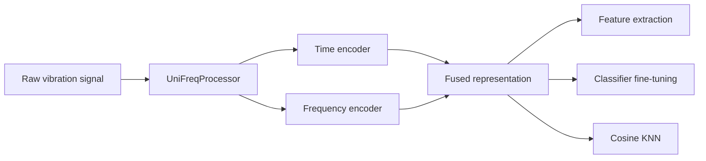

<div align="center">

# UniFreq

**Pretrained time–frequency representations for machinery fault diagnosis**

<p>
  <a href="https://huggingface.co/bojian1/UniFreq"></a>
  <a href="https://huggingface.co/datasets/bojian1/PHMFD-data"></a>
  
  
  <a href="LICENSE"></a>
</p>

[中文文档](README_zh.md) · [Model Zoo](#model-zoo) · [Quick Start](#quick-start) · [Downstream Tasks](#downstream-tasks) · [PHMFD Data](#phmfd-data)

</div>

UniFreq is a compact dual-branch encoder that turns variable-length,
multi-channel vibration signals into time-domain, frequency-domain, and fused
representations. Public checkpoints can be downloaded directly from Hugging
Face and loaded safely with `safetensors`.

This repository is designed for downstream use: feature extraction, supervised
classifier fine-tuning, and parameter-free KNN evaluation. It does not include
the pretraining pipeline.

## ✨ Highlights

- **Dual-domain representation** — complementary Transformer encoders model
  temporal patterns and frequency structure.
- **Flexible inputs** — supports variable-length, single-channel, and
  multi-channel signals.
- **Three usage modes** — extract embeddings, fine-tune a classifier, or run
  cosine KNN without training parameters.
- **Ready-to-use checkpoints** — tiny, small, and base variants are hosted on
  Hugging Face.
- **Safe and lightweight** — checkpoints use `safetensors`; Parquet data is
  streamed in batches instead of loaded all at once.



<a id="model-zoo"></a>

## 📦 Model Zoo

| Model | Time dim | Frequency dim | Fused dim | Heads | Layers / branch | Parameters | Weights |
| --- | ---: | ---: | ---: | ---: | ---: | ---: | ---: |
| [UniFreq-tiny](https://huggingface.co/bojian1/UniFreq-tiny) | 64 | 64 | 128 | 2 | 4 | 420K | 1.69 MB |
| [UniFreq-small](https://huggingface.co/bojian1/UniFreq-small) | 96 | 96 | 192 | 3 | 4 | 941K | 3.78 MB |
| [UniFreq-base](https://huggingface.co/bojian1/UniFreq-base) | 128 | 128 | 256 | 4 | 4 | 1.67M | 6.69 MB |

All variants use a 0.1-second input window, 800 non-DC frequency bins, four
Transformer layers per domain, and harmonic-aware frequency positional
encoding.

<a id="quick-start"></a>

## 🚀 Quick Start

### 1. Install

Python 3.9 or newer is required.

```bash
git clone https://github.com/Bojian-Chen/UniFreq.git
cd UniFreq

python -m venv .venv
source .venv/bin/activate
python -m pip install --upgrade pip
python -m pip install -r requirements.txt
```

For GPU execution, install the PyTorch build matching your CUDA version before
installing the remaining requirements.

### 2. Extract features in Python

```python
import numpy as np
import torch

from model import UniFreqProcessor, load_model

device = torch.device("cuda" if torch.cuda.is_available() else "cpu")
model, config = load_model("bojian1/UniFreq-base")
model = model.to(device)
processor = UniFreqProcessor(config)

signals = [
    np.random.randn(2048).astype("float32"),
    np.random.randn(1600).astype("float32"),
]
batch = {
    name: value.to(device)
    for name, value in processor(signals).items()
}

with torch.inference_mode():
    features = model(batch)

print(features.shape)  # torch.Size([2, 256])
```

Samples in the same batch may have different lengths, but they must have the
same number of channels. `UniFreqProcessor` applies all checkpoint-specific
normalization, FFT, truncation, tail-statistics, masking, and padding settings.

### 3. Extract features from a file

`inference.py` accepts `.parquet`, `.npy`, and `.npz` inputs:

```bash
python inference.py \
  --model-id bojian1/UniFreq-base \
  --input samples.npy \
  --input-layout NL \
  --batch-size 32 \
  --device auto \
  --output features.npz
```

The model is downloaded automatically on first use. `--model-id` may also point
to a local directory containing `config.json` and `model.safetensors`.

<a id="downstream-tasks"></a>

## 🧠 Downstream Tasks

Processed Parquet files are expected to contain `samples` and `labels` columns.
UniFreq provides two downstream workflows through `downstream.py`.

| Workflow | Learned parameters | Required splits | Main outputs |
| --- | --- | --- | --- |
| Classifier fine-tuning | Encoder + added MLP classifier | train / validation / test | Best weights, metrics, predictions |
| Cosine KNN | None | reference / test | Metrics, predictions |

### Classifier fine-tuning

The added classifier uses
`LayerNorm → Linear → GELU → Dropout → Linear`. The best epoch is selected by
validation macro-F1, then reloaded for final test evaluation.

```bash
python downstream.py finetune \
  --model-id bojian1/UniFreq-base \
  --train-file data/Process_data/IMS_FD/train.parquet \
  --val-file data/Process_data/IMS_FD/val.parquet \
  --test-file data/Process_data/IMS_FD/test.parquet \
  --epochs 100 \
  --batch-size 64 \
  --backbone-lr-scale 1.0 \
  --device auto \
  --output-dir outputs/ims_fd_finetune
```

The encoder and classifier are fine-tuned together by default. Set
`--backbone-lr-scale 0` to freeze UniFreq and train only the classifier.

The output directory contains the best `model.safetensors`,
`classifier.safetensors`, their JSON configurations, `metrics.json`, and
per-sample `predictions.csv`.

### Cosine KNN

KNN L2-normalizes reference and query features, computes cosine similarity, and
uses unweighted majority voting.

```bash
python downstream.py knn \
  --model-id bojian1/UniFreq-base \
  --reference-file data/Process_data/PU/train_1p.parquet \
  --test-file data/Process_data/PU/test.parquet \
  --neighbors 5 \
  --device auto \
  --output-dir outputs/pu_knn
```

For K-shot evaluation, pass a processed split such as
`train_5shot.parquet` or `train_10shot.parquet` as the reference file.

<a id="phmfd-data"></a>

## 🗃️ PHMFD Data

Processed datasets are documented in
[PHMFD-data-preprocessing](https://github.com/Bojian-Chen/PHMFD-data-preprocessing)
and hosted in the
[PHMFD-data](https://huggingface.co/datasets/bojian1/PHMFD-data) repository.

Download a processed split with the Hugging Face CLI:

```bash
hf download bojian1/PHMFD-data \
  --repo-type dataset \
  --include "Process_data/PU/train_1shot.parquet" \
  --local-dir data
```

Run feature extraction directly on the downloaded Parquet file:

```bash
python inference.py \
  --model-id bojian1/UniFreq-base \
  --input data/Process_data/PU/train_1shot.parquet \
  --input-key samples \
  --batch-size 8 \
  --device auto \
  --output pu_features.npz
```

## 📐 Input and Output Reference

<details>
<summary><strong>Supported array layouts</strong></summary>

| Layout | Meaning | Shape |
| --- | --- | --- |
| `L` | One single-channel sample | `[L]` |
| `NL` | Batch of single-channel samples | `[N, L]` |
| `CL` | One channel-first sample | `[C, L]` |
| `LC` | One channel-last sample | `[L, C]` |
| `NCL` | Channel-first batch | `[N, C, L]` |
| `NLC` | Channel-last batch | `[N, L, C]` |

</details>

<details>
<summary><strong>Feature archive contents</strong></summary>

| Array | Description |
| --- | --- |
| `features` | Fused time-frequency representations |
| `time_features` | Time-branch representations |
| `frequency_features` | Frequency-branch representations |
| `logits` | Optional classifier output when a compatible head is present |

</details>

## 🗂️ Repository Layout

```text
UniFreq/
├── downstream.py          # Classifier fine-tuning and KNN
├── inference.py           # Feature extraction CLI
├── config.example.json
├── model/
│   ├── config.py
│   ├── hub.py             # Hugging Face checkpoint loading
│   ├── preprocessing.py
│   ├── unifreq.py
│   ├── time_frequency_common.py
│   └── time_frequency_tokenizers.py
└── requirements.txt
```

## 🔒 Checkpoint Format

Each model repository contains:

```text
config.json
model.safetensors
```

Only `safetensors` weights are accepted. Pickled checkpoints are intentionally
unsupported.

## 📄 License

UniFreq is released under the [MIT License](LICENSE).

## UniFault and TF-ProFM

The same inference API also loads the PHMFD implementations of UniFault and
TF-ProFM. Architecture and preprocessing are selected by `config.json`.

| Checkpoint | Feature dimension | Preprocessing |
| --- | ---: | --- |
| [UniFault-tiny](https://huggingface.co/bojian1/UniFault-tiny) | 128 | Resample to 1024 points; per-channel min-max |
| [UniFault-small](https://huggingface.co/bojian1/UniFault-small) | 256 | Resample to 1024 points; per-channel min-max |
| [TF-ProFM](https://huggingface.co/bojian1/TF-ProFM) | 4096 | Resample shorter signals / truncate longer signals to 2048 points; per-channel z-score |

Each repository defaults to training seed 42 and also provides `seed-42`,
`seed-43`, and `seed-44` revisions. These are pretrained backbone weights,
without fault-label classifiers or pretraining projection heads. UniFault
returns mean-pooled token features; TF-ProFM returns channel-averaged features.
Only UniFreq outputs `time_features` and `frequency_features`.

```bash
python inference.py --model-id bojian1/UniFault-small \
  --input samples.npy --output unifault_features.npz
python inference.py --model-id bojian1/TF-ProFM --revision seed-43 \
  --input samples.npy --output tf_profm_features.npz --seed 42
```

TF-ProFM retains the original random patch sampling. `--seed` controls inference
randomness independently of the checkpoint training seed. Keep device, batch
size, input order and seed fixed for reproducibility. In Python, use
`torch.manual_seed(42)` before the forward pass. Published UniFault checkpoints
require single-channel input. KNN and explicit downstream fine-tuning also use
these models through the existing `downstream.py` commands.

UniFault-base **architecture support** is included (512 dimensions, 12 heads,
16 layers). Its attention projects to `12 * floor(512 / 12) = 504` dimensions,
matching the original implementation. The
[base configuration template](configs/unifault-base.example.json) is a structural
example, not a pretrained checkpoint. No UniFault-base pretraining checkpoint
was found in the available PHMFD `log/unifault` directory; no base weights have
been published. `bojian1/UniFreq-base` is a different architecture.

Checkpoint source paths, SHA256 hashes and Hub commit IDs are recorded in
[published_checkpoints.json](docs/published_checkpoints.json). Each model's Hub
repository also contains `provenance.json`.
