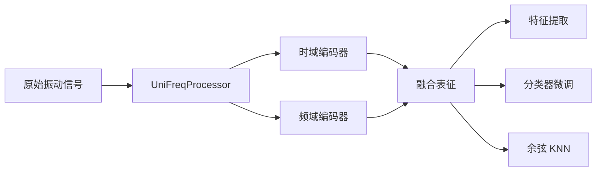

<div align="center">

# UniFreq

**面向机械故障诊断的预训练时频表征模型**

<p>
  <a href="https://huggingface.co/bojian1/UniFreq"></a>
  <a href="https://huggingface.co/datasets/bojian1/PHMFD-data"></a>
  
  
  <a href="LICENSE"></a>
</p>

[English](README.md) · [模型列表](#model-zoo) · [快速开始](#quick-start) · [下游任务](#downstream-tasks) · [PHMFD 数据](#phmfd-data)

</div>

UniFreq 是一个紧凑的双分支编码器，可将变长、多通道振动信号转换为时域、频域
和融合表征。公开 checkpoint 托管在 Hugging Face，并通过 `safetensors`
安全加载。

本仓库专注于下游使用，包括特征提取、监督分类器微调和无参数 KNN 评估，不包含
预训练流程。

## ✨ 主要特点

- **双域表征**：使用两个互补的 Transformer 编码器分别建模时域模式和频率结构。
- **灵活输入**：支持变长、单通道和多通道信号。
- **三种使用方式**：提取特征、微调分类器，或直接运行无需训练参数的余弦 KNN。
- **开箱即用**：tiny、small 和 base 三种 checkpoint 均托管在 Hugging Face。
- **安全轻量**：权重使用 `safetensors`；Parquet 数据按 batch 流式读取。



<a id="model-zoo"></a>

## 📦 模型列表

| 模型 | 时域维度 | 频域维度 | 融合维度 | 注意力头 | 每分支层数 | 参数量 | 权重大小 |
| --- | ---: | ---: | ---: | ---: | ---: | ---: | ---: |
| [UniFreq-tiny](https://huggingface.co/bojian1/UniFreq-tiny) | 64 | 64 | 128 | 2 | 4 | 42 万 | 1.69 MB |
| [UniFreq-small](https://huggingface.co/bojian1/UniFreq-small) | 96 | 96 | 192 | 3 | 4 | 94 万 | 3.78 MB |
| [UniFreq-base](https://huggingface.co/bojian1/UniFreq-base) | 128 | 128 | 256 | 4 | 4 | 167 万 | 6.69 MB |

三个版本均使用 0.1 秒输入窗口、800 个非直流频点、每个域 4 层 Transformer，
以及谐波感知的频率位置编码。

<a id="quick-start"></a>

## 🚀 快速开始

### 1. 安装

需要 Python 3.9 或更高版本。

```bash
git clone https://github.com/Bojian-Chen/UniFreq.git
cd UniFreq

python -m venv .venv
source .venv/bin/activate
python -m pip install --upgrade pip
python -m pip install -r requirements.txt
```

使用 GPU 时，请先安装与本机 CUDA 版本匹配的 PyTorch，再安装其余依赖。

### 2. 使用 Python 提取特征

```python
import numpy as np
import torch

from model import UniFreqProcessor, load_model

device = torch.device("cuda" if torch.cuda.is_available() else "cpu")
model, config = load_model("bojian1/UniFreq-base")
model = model.to(device)
processor = UniFreqProcessor(config)

signals = [
    np.random.randn(2048).astype("float32"),
    np.random.randn(1600).astype("float32"),
]
batch = {
    name: value.to(device)
    for name, value in processor(signals).items()
}

with torch.inference_mode():
    features = model(batch)

print(features.shape)  # torch.Size([2, 256])
```

同一 batch 内的样本可以具有不同长度，但通道数必须一致。`UniFreqProcessor`
会根据 checkpoint 配置完成归一化、FFT、频点截取、尾部统计、mask 和 padding。

### 3. 从文件提取特征

`inference.py` 支持 `.parquet`、`.npy` 和 `.npz` 输入：

```bash
python inference.py \
  --model-id bojian1/UniFreq-base \
  --input samples.npy \
  --input-layout NL \
  --batch-size 32 \
  --device auto \
  --output features.npz
```

模型会在首次使用时自动下载。`--model-id` 也可以指向包含 `config.json` 和
`model.safetensors` 的本地目录。

<a id="downstream-tasks"></a>

## 🧠 下游任务

处理后的 Parquet 文件应包含 `samples` 和 `labels` 两列。UniFreq 通过
`downstream.py` 提供两种下游流程。

| 流程 | 训练参数 | 所需划分 | 主要输出 |
| --- | --- | --- | --- |
| 分类器微调 | 编码器与新增的 MLP 分类器 | train / validation / test | 最佳权重、指标、预测 |
| 余弦 KNN | 无 | reference / test | 指标、预测 |

### 分类器微调

新增分类器采用
`LayerNorm → Linear → GELU → Dropout → Linear`。程序按验证集 macro-F1
选择最佳 epoch，并重新加载最佳权重完成最终测试。

```bash
python downstream.py finetune \
  --model-id bojian1/UniFreq-base \
  --train-file data/Process_data/IMS_FD/train.parquet \
  --val-file data/Process_data/IMS_FD/val.parquet \
  --test-file data/Process_data/IMS_FD/test.parquet \
  --epochs 100 \
  --batch-size 64 \
  --backbone-lr-scale 1.0 \
  --device auto \
  --output-dir outputs/ims_fd_finetune
```

默认同时微调编码器和分类器。设置 `--backbone-lr-scale 0` 可以冻结 UniFreq，
仅训练新增分类器。

输出目录包含最佳 `model.safetensors`、`classifier.safetensors`、对应的 JSON
配置、`metrics.json` 和逐样本 `predictions.csv`。

### 余弦 KNN

KNN 会对 reference 和 query 特征执行 L2 归一化，计算余弦相似度，并使用无权重
多数投票。

```bash
python downstream.py knn \
  --model-id bojian1/UniFreq-base \
  --reference-file data/Process_data/PU/train_1p.parquet \
  --test-file data/Process_data/PU/test.parquet \
  --neighbors 5 \
  --device auto \
  --output-dir outputs/pu_knn
```

进行 K-shot 评估时，将 `train_5shot.parquet` 或 `train_10shot.parquet` 等处理后
划分作为 reference 文件。

<a id="phmfd-data"></a>

## 🗃️ PHMFD 数据

处理后数据集的格式和目录结构见
[PHMFD-data-preprocessing](https://github.com/Bojian-Chen/PHMFD-data-preprocessing)，
数据文件托管在
[PHMFD-data](https://huggingface.co/datasets/bojian1/PHMFD-data)。

使用 Hugging Face CLI 下载一个处理后的数据划分：

```bash
hf download bojian1/PHMFD-data \
  --repo-type dataset \
  --include "Process_data/PU/train_1shot.parquet" \
  --local-dir data
```

直接对下载的 Parquet 文件提取特征：

```bash
python inference.py \
  --model-id bojian1/UniFreq-base \
  --input data/Process_data/PU/train_1shot.parquet \
  --input-key samples \
  --batch-size 8 \
  --device auto \
  --output pu_features.npz
```

## 📐 输入与输出参考

<details>
<summary><strong>支持的数组布局</strong></summary>

| 布局 | 含义 | 形状 |
| --- | --- | --- |
| `L` | 一个单通道样本 | `[L]` |
| `NL` | 一批单通道样本 | `[N, L]` |
| `CL` | 一个通道优先样本 | `[C, L]` |
| `LC` | 一个通道置后样本 | `[L, C]` |
| `NCL` | 一批通道优先样本 | `[N, C, L]` |
| `NLC` | 一批通道置后样本 | `[N, L, C]` |

</details>

<details>
<summary><strong>特征压缩包内容</strong></summary>

| 数组 | 说明 |
| --- | --- |
| `features` | 时频融合表征 |
| `time_features` | 时域分支表征 |
| `frequency_features` | 频域分支表征 |
| `logits` | checkpoint 包含兼容分类头时的可选分类结果 |

</details>

## 🗂️ 仓库结构

```text
UniFreq/
├── downstream.py          # 分类器微调与 KNN
├── inference.py           # 特征提取命令行入口
├── config.example.json
├── model/
│   ├── config.py
│   ├── hub.py             # Hugging Face checkpoint 加载
│   ├── preprocessing.py
│   ├── unifreq.py
│   ├── time_frequency_common.py
│   └── time_frequency_tokenizers.py
└── requirements.txt
```

## 🔒 Checkpoint 格式

每个模型仓库包含：

```text
config.json
model.safetensors
```

加载器仅接受 `safetensors` 权重，有意不支持 pickle checkpoint。

## 📄 许可证

UniFreq 使用 [MIT License](LICENSE)。
